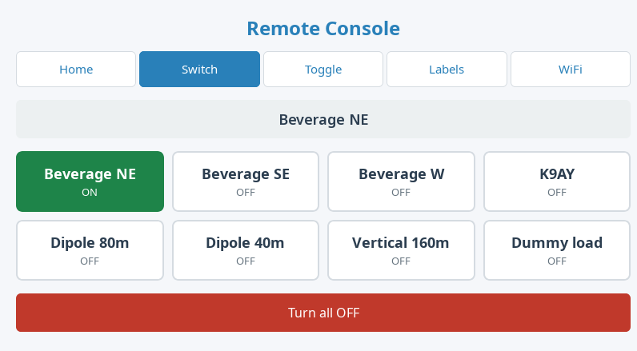
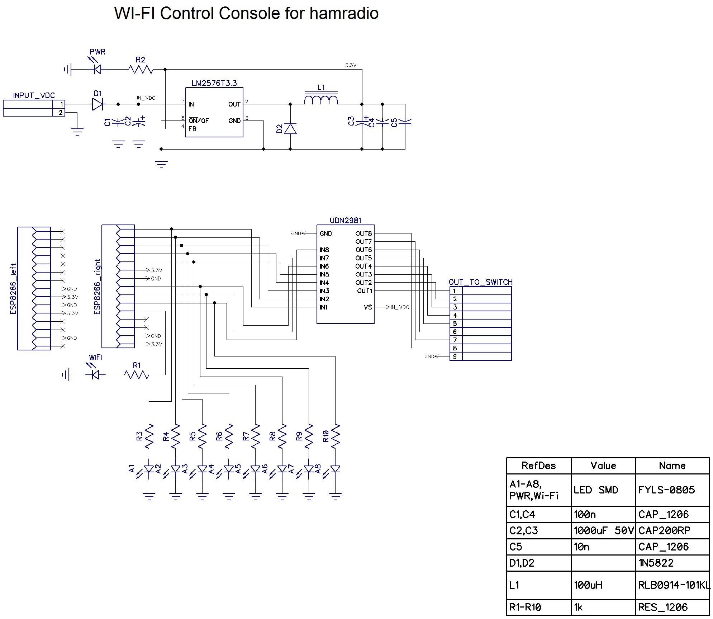
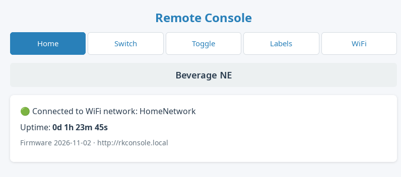
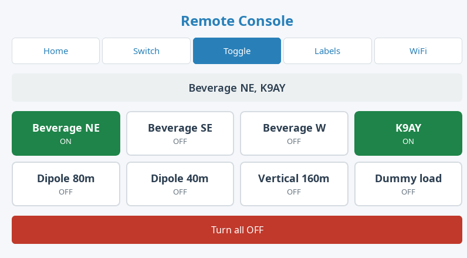
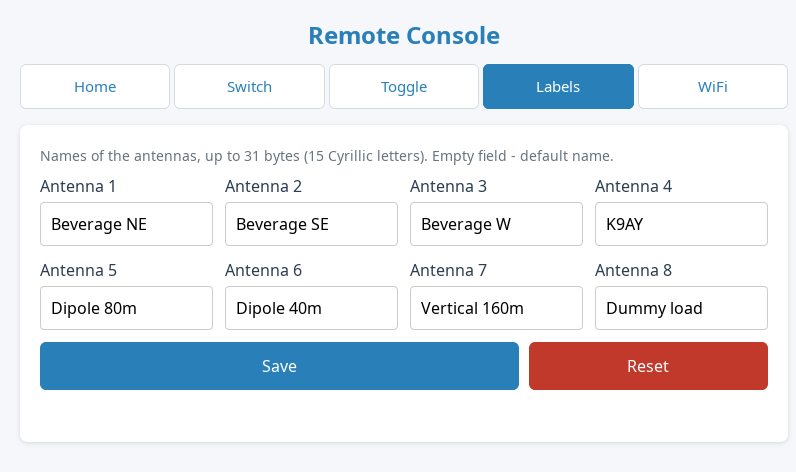
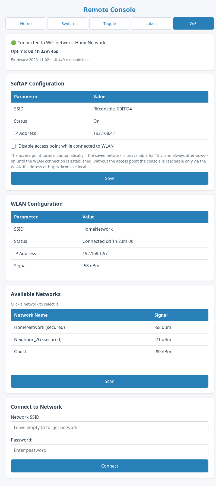
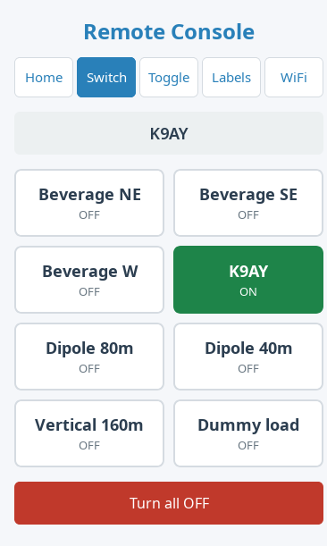
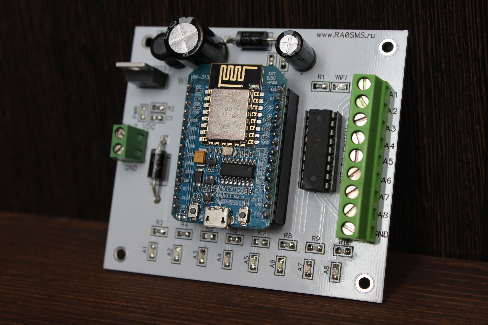
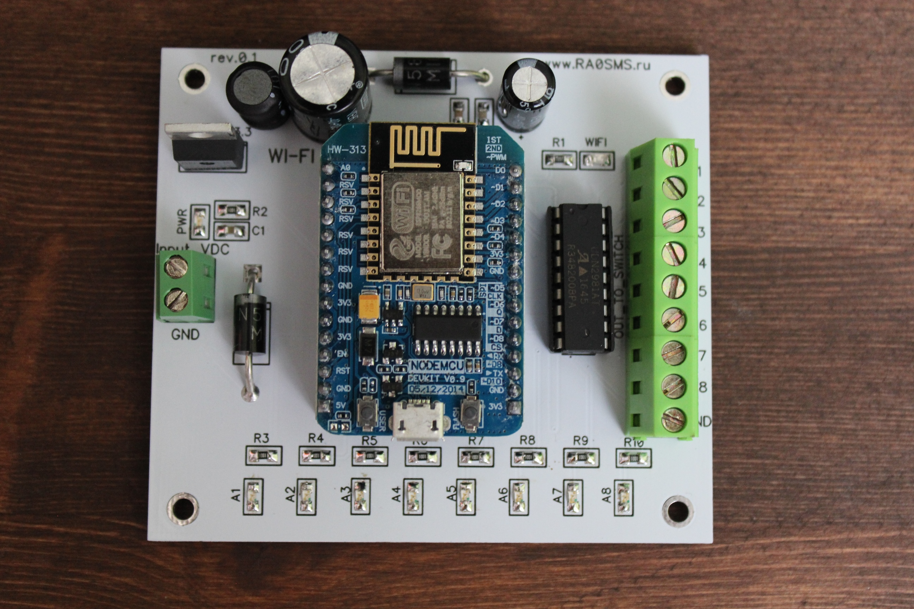
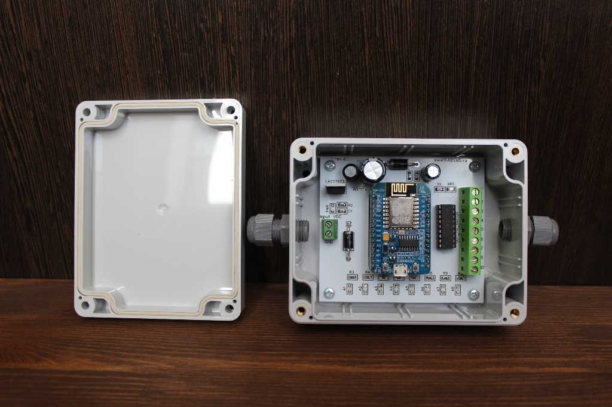

# Wi-Fi control console for antenna switches

A small box that controls an external antenna switch over Wi-Fi from any web browser on a phone, tablet or PC. Scripts and logging software can use its simple HTTP API.

It has 8 high-side outputs, so it works with switches that use a positive control voltage on each line, from 5 to 45 V.



## Features

* **8 outputs (A1–A8)** with an LED for each output
* **Two control modes**: antenna switch (one output at a time) and toggle (independent outputs)
* **Custom antenna names**, Cyrillic and other UTF-8 characters are supported
* **Web interface without page reloads**: the buttons respond at once, and changes made from another device appear by themselves
* **Wi-Fi access point and client at the same time**: connect directly to the box or through your home network
* **Captive portal and mDNS**: the setup page opens by itself, and the box is available at `http://rkconsole.local`
* **Automatic reconnect** when the home network is lost
* **HTTP/JSON API** for automation
* Open hardware (DipTrace) and open source firmware (Arduino IDE)

## Hardware

| Parameter | Value |
|---|---|
| Supply voltage | 5–45 V DC, depending on the voltage used in the antenna switch |
| Own current consumption | not more than 70 mA |
| Output current | up to 500 mA |
| Controller | ESP8266 (NodeMCU module) |
| Output driver | UDN2981 |
| Wi-Fi | 2.4 GHz only, range up to 50 m with an entry-level router |
| Case | 115 × 88 × 55 mm, ABS, IP68, cable glands for 3–7 mm cable |

| Terminal / LED | Purpose |
|---|---|
| `INPUT_VDC` | Power supply |
| `OUT_TO_SWITCH` | Antenna switch: pins 1–8 are the outputs, pin 9 is GND |
| `PWR` | Power is on |
| `WIFI` | Connected to the home Wi-Fi network |
| `A1`–`A8` | Output is on |

All outputs are off after power-on. The previous state is not restored.

Schematic:



The schematic, PCB and Gerber files are in the [DipTrace](DipTrace/) folder.

## Quick start

Your router must have a 2.4 GHz network and DHCP enabled.

1. Power on the box. It creates a Wi-Fi access point:
   * Network name: **`RKconsole_XXXXXX`**, where `XXXXXX` is the unique chip ID (it is also printed to the serial port at startup)
   * Password: **`1234567890`**
2. Connect your phone or PC to this network. Most devices open the console page by themselves. If yours does not, open **http://192.168.4.1** in a browser.
3. Open the **WiFi** tab, click your network in the list, enter the password and press **Connect**.
4. When the `WIFI` LED lights up, the WiFi page shows the IP address on your network. Reconnect your device to your home network and open the console at:
   * **http://rkconsole.local** (Windows 10+, macOS, iOS, Linux; some Android devices cannot open it), or
   * the IP address from the WiFi page (it is also in the DHCP client list of your router).

Use a modern browser. Internet Explorer is not supported.

## Web interface

| Tab | Address | Description |
|---|---|---|
| Home | `/` | Current antenna, connection status, uptime, firmware version |
| Switch | `/switch` | One output at a time |
| Toggle | `/toggle` | Independent outputs |
| Labels | `/label` | Antenna names |
| WiFi | `/wifi` | Access point and network settings |

### Home



### Switch

A button turns on its output and turns off all the others. Pressing the only active button again turns it off. **Turn all OFF** turns off everything.

The line at the top shows the active antennas. The page refreshes every 2 seconds. If the console cannot be reached, the line turns red.


### Toggle

Each button switches only its own output, so several outputs can be on at once.



### Labels

Each name can be up to 31 bytes long: 31 Latin or about 15 Cyrillic letters. An empty field restores the default name (A1–A8). **Reset** restores all default names.



### WiFi

* Name, status and address of the access point
* **Disable access point while connected to WLAN**: the access point turns off 30 seconds after the box connects to your network. It turns back on if the network is unavailable for 15 seconds, and it is always on after power-on until the connection is established. If you lose access, power-cycle the box and connect to `RKconsole_XXXXXX`.
* Saved network, connection status, IP address and signal level
* Available networks sorted by signal level (click a row to fill in the name, **Scan** refreshes the list)
* SSID up to 32 characters, password 8–64 characters (empty for an open network)
* To make the box forget the saved network, press **Connect** with an empty SSID

If the network cannot be reached (router off, wrong password), the box retries every 60 seconds. The access point stays on in the meantime.



### On a phone

The buttons are arranged in two columns.



## HTTP API

**Read state**

```
GET /api/state
```
```json
{"mask":5,"labels":["A1","A2","A3","A4","A5","A6","A7","A8"]}
```

Bit N of `mask` means that channel N is on: channel 0 is A1, channel 7 is A8. In this example A1 and A3 are on.

**Change state** (`POST`, form-encoded)

| Parameter | Action |
|---|---|
| `sel=0..7` | Turn on only this channel, turn off all others |
| `ch=0..7` and `on=0\|1` | Switch one channel, the others do not change |
| `off=1` | Turn off all channels |

The response is the new state in the same format as `/api/state`. An invalid value returns HTTP 400. Outputs that go off are released before the new ones turn on.

```sh
curl -d "sel=2" http://rkconsole.local/set
curl -d "ch=5&on=1" http://rkconsole.local/set
curl -d "off=1" http://rkconsole.local/set
curl http://rkconsole.local/api/state
```

**Other endpoints**

* `GET /api/info`: network status, uptime, firmware version, free heap
* `GET /api/scan`: Wi-Fi scan results (`{"scanning":true}` while the scan is running)

## Firmware

Source: [src/server/server.ino](src/server/server.ino)

### Building

1. Install the [ESP8266 Arduino core](https://github.com/esp8266/Arduino) 3.1.2. No extra libraries are needed.
2. Select the board **Generic ESP8266 Module**, Flash Size **1MB (FS:64KB)**, Flash Mode **DOUT**, Reset Method **NodeMCU**.
3. Upload through the USB port of the NodeMCU module.

The same build also runs on modules with a larger flash chip.

### Prebuilt binaries

* [server_without_auth.bin](src/server/server_without_auth.bin): no login
* [server_with_auth.bin](src/server/server_with_auth.bin): login `admin`, password `password123`

Both are built with the settings above. Flashing keeps the saved settings:

```sh
esptool --port /dev/ttyUSB0 write_flash 0x0 server_without_auth.bin
```

### Settings in the source code

| Constant | Default | Description |
|---|---|---|
| `softAP_password` | `1234567890` | Access point password (at least 8 characters) |
| `myHostname` | `rkconsole` | mDNS name (`http://rkconsole.local`) |
| `AUTH` | `false` | Require a login for the web interface and API |
| `www_username` / `www_password` | `admin` / `password123` | Login, used when `AUTH` is `true` |

Change these values before relying on them: the defaults are public. Do not expose the console directly to the Internet.

### Stored data

Wi-Fi credentials, antenna names and the access point option are stored in a dedicated flash sector, the fifth from the end of the flash. The last four sectors belong to the Wi-Fi SDK, so the firmware must not write there.

### Updating from older firmware

* Saved settings are moved automatically on the first start. The box then wipes the SDK sectors and restarts once. Older firmware kept its settings inside these sectors, which caused Exception 9 crashes while reconnecting.
* The access point name changes from `RKconsole_snNNN` to `RKconsole_XXXXXX`.
* The old addresses `/socketNOn`, `/socketNOff`, `/socNOn`, `/socNOff`, `/xml`, `/APon` and `/APoff` are gone. Use `/set` and `/api/state`.

### Pinout

| Output | GPIO | NodeMCU pin |
|---|---|---|
| A1 | 16 | D0 |
| A2 | 5 | D1 |
| A3 | 4 | D2 |
| A4 | 0 | D3 |
| A5 | 2 | D4 |
| A6 | 14 | D5 |
| A7 | 12 | D6 |
| A8 | 13 | D7 |
| `WIFI` LED | 15 | D8 |

GPIO0, GPIO2 and GPIO15 are also the ESP8266 boot mode pins.

## Documentation

* [Manual (EN)](docs/Manual_console_en.pdf), [editable version](docs/Manual_console_en.docx)
* [Manual (RU)](docs/Manual_console_rus.pdf), [editable version](docs/Manual_console_rus.docx)

## Photos







## License

MIT, see [LICENSE](LICENSE). © 2015-2024 Anton Gavrilov RA0SMS

More projects: https://ra0sms.com/
